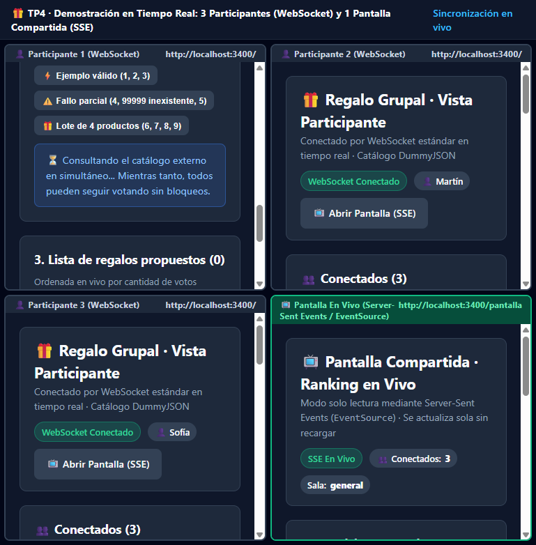
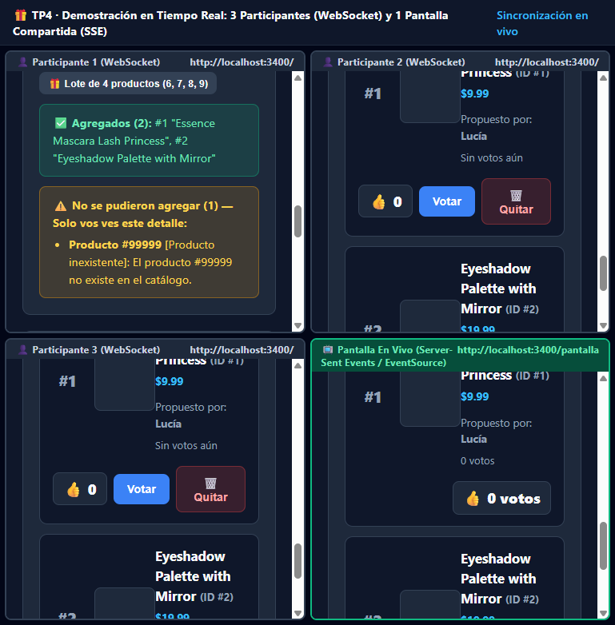
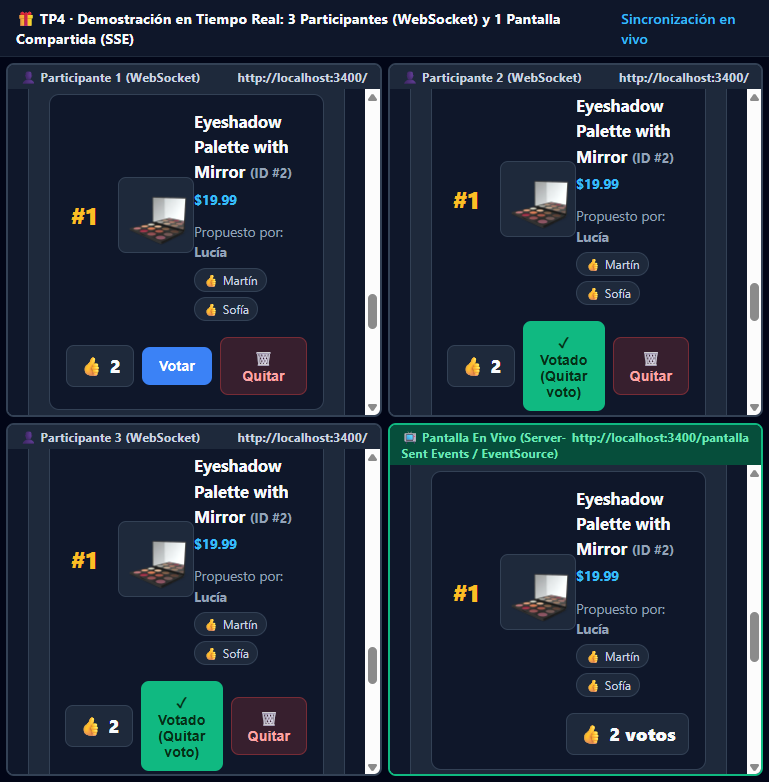
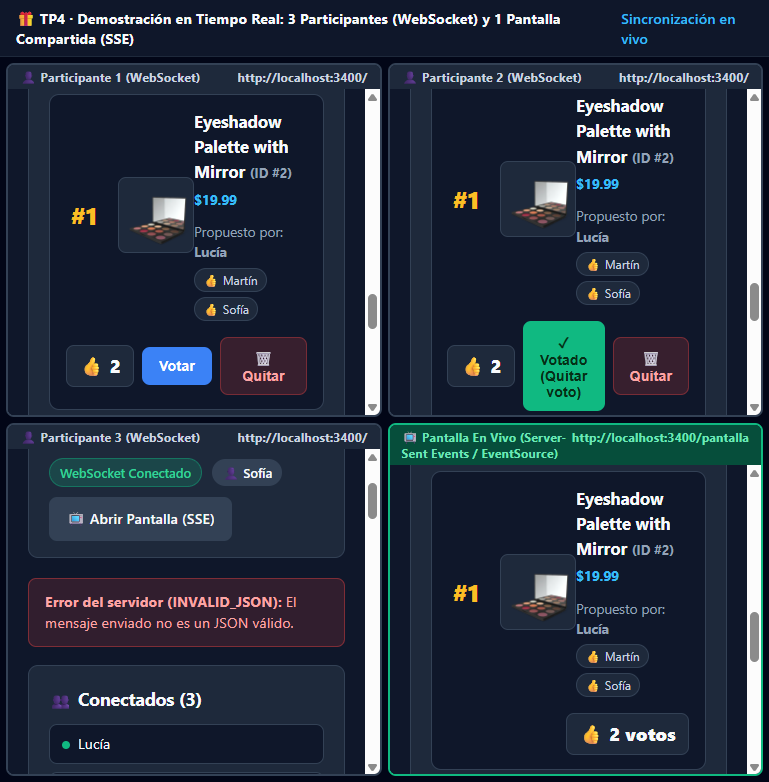

# TP4 · Asincronismo e integración con Node.js y TypeScript

Aplicación de **lista compartida en tiempo real** para elegir un regalo grupal, construida con **Node.js y TypeScript**, comunicando a los participantes mediante **WebSocket estándar**, a la pantalla compartida mediante **Server-Sent Events (`EventSource`)**, e integrada de forma asíncrona, concurrente y tolerante a fallos con el catálogo externo de **[DummyJSON](https://dummyjson.com/docs/products)**.

---

## 🌐 Demo desplegada en vivo (Render)

- **👤 Vista Participante (WebSocket):** [https://tp4web.onrender.com/](https://tp4web.onrender.com/)
- **📺 Vista Pantalla Compartida (SSE):** [https://tp4web.onrender.com/pantalla](https://tp4web.onrender.com/pantalla)
- **🖥️ Vista Demo 4 Paneles Simultáneos:** [https://tp4web.onrender.com/demo](https://tp4web.onrender.com/demo)

---

## 🚀 Cómo instalar y ejecutar el proyecto localmente

### Requisitos previos
- **Node.js** v20 LTS o superior (probado en Node.js v24).
- **npm**.

### 1. Instalar dependencias

```bash
npm install
```

### 2. Ejecutar el servidor

- **Modo normal (catálogo sin demora artificial):**
  ```bash
  npm start
  ```
- **Modo desarrollo (recarga automática al editar archivos `.ts`):**
  ```bash
  npm run dev
  ```
- **Simular un catálogo lento (sin modificar el código):**
  Podés configurar variables de entorno al iniciar el servidor. Por ejemplo, para que DummyJSON demore `2500 ms` en cada respuesta con un timeout máximo de `4000 ms`:
  ```bash
  # En PowerShell (Windows):
  $env:CATALOG_DELAY_MS="2500"; $env:CATALOG_TIMEOUT_MS="4000"; npm start

  # En Bash / Linux / macOS:
  CATALOG_DELAY_MS=2500 CATALOG_TIMEOUT_MS=4000 npm start
  ```
  También podés forzar que el catálogo venza por timeout configurando un `CATALOG_DELAY_MS` mayor que `CATALOG_TIMEOUT_MS`:
  ```bash
  # En PowerShell (Windows):
  $env:CATALOG_DELAY_MS="3500"; $env:CATALOG_TIMEOUT_MS="1500"; npm start
  ```

### 3. Abrir los clientes en el navegador
Un único servidor en el puerto `3000` (configurable con `PORT`) sirve todo:
- **Vista Participante (WebSocket):** `http://localhost:3000/`
- **Vista Pantalla Compartida (SSE):** `http://localhost:3000/pantalla`
- **Vista Demo 4 Paneles (3 Participantes + 1 Pantalla SSE en simultáneo):** `http://localhost:3000/demo`

### 4. Ejecutar las pruebas automatizadas (`node:test`)
```bash
npm test
```

---

## 📸 Evidencia (GIF y Capturas de Funcionamiento)

Toda la evidencia visual solicitada se encuentra en la carpeta [`evidencia/`](evidencia/):

### 2. Comportamiento con el catálogo lento
Mientras el Participante 1 (`Lucía`) espera la respuesta demorada de DummyJSON (`?delay=2000`), ve el aviso de consulta en curso y los demás participantes siguen conectados y votando sin bloqueos:



### 3. Propuesta con fallos parciales (`1, 99999, 2`)
Al proponer los IDs `1, 99999, 2` en una sola acción, los productos `#1` y `#2` se agregan para todos (incluyendo la pantalla SSE), mientras que el error del producto `#99999` (`Producto inexistente`) se muestra **únicamente a quien hizo la propuesta** (`Lucía`):



### 4. Tres participantes y la pantalla sincronizados con el ranking en vivo
Después de que `Martín` y `Sofía` votan el producto `#2` y agregan el producto `#3`, el ranking se ordena automáticamente por cantidad de votos en todas las vistas sin recargar la página:



### 5. Respuesta del servidor ante un mensaje inválido
Cuando el Participante 3 (`Sofía`) envía un mensaje inválido por WebSocket, el servidor le responde con un `ERROR` (`INVALID_JSON`) **únicamente a ella** y el resto de los participantes y la pantalla siguen funcionando con normalidad:



---

## ⚙️ Variables de entorno (Configuración sin modificar el código)

| Variable | Valor por defecto | Descripción |
| :--- | :--- | :--- |
| `PORT` | `3000` | Puerto único donde escuchan HTTP, WebSocket (`/ws`) y SSE (`/events`). |
| `CATALOG_BASE_URL` | `https://dummyjson.com/products` | URL base del catálogo externo de productos. |
| `CATALOG_TIMEOUT_MS` | `4000` | Tiempo máximo de espera (en milisegundos) por cada consulta al catálogo. |
| `CATALOG_DELAY_MS` | `0` | Milisegundos agregados como parámetro `?delay=<ms>` a DummyJSON para simular lentitud del servicio externo. |

---

## 📜 Contrato de Mensajes

Todos los mensajes intercambiados son objetos **JSON**, tienen un campo discriminador `type` (en WebSocket) o nombre de evento (en SSE) y están estrictamente tipados en [`src/types.ts`](src/types.ts).

### 1. Mensajes Cliente Participante ➔ Servidor (WebSocket `/ws`)

| Tipo (`type`) | Dirección | Campos del JSON | Cuándo se envía |
| :--- | :--- | :--- | :--- |
| `JOIN` | Cliente ➔ Servidor | `type: "JOIN"`, `name: string`, `roomCode?: string` | Cuando una persona ingresa su nombre para entrar a la lista compartida (o al reconectarse automáticamente). |
| `PROPOSE_PRODUCTS` | Cliente ➔ Servidor | `type: "PROPOSE_PRODUCTS"`, `productIds: number[]` (1 a 10 enteros positivos), `requestId?: string` | Cuando un participante propone entre 1 y 10 IDs de productos del catálogo en una sola acción. |
| `VOTE_PRODUCT` | Cliente ➔ Servidor | `type: "VOTE_PRODUCT"`, `productId: number` | Cuando un participante vota un producto que está en la lista. |
| `UNVOTE_PRODUCT` | Cliente ➔ Servidor | `type: "UNVOTE_PRODUCT"`, `productId: number` | Cuando un participante retira su voto de un producto que había votado previamente. |
| `REMOVE_PRODUCT` | Cliente ➔ Servidor | `type: "REMOVE_PRODUCT"`, `productId: number` | Cuando un participante solicita quitar un producto de la lista. |
| `PING` | Cliente ➔ Servidor | `type: "PING"` | Mensaje opcional de diagnóstico/latido desde el cliente. |

### 2. Mensajes Servidor ➔ Cliente Participante (WebSocket `/ws`)

| Tipo (`type`) | Dirección | Campos del JSON | Cuándo se envía |
| :--- | :--- | :--- | :--- |
| `WELCOME` | Servidor ➔ Cliente (individual) | `type: "WELCOME"`, `name: string`, `roomCode: string`, `state: RoomStateSnapshot`, `config: { catalogTimeoutMs, catalogDelayMs, removePolicy }` | Inmediatamente después de un `JOIN` válido. Entrega el estado completo actual de la lista y los participantes conectados sin esperar a que alguien haga un cambio. |
| `STATE_UPDATED` | Servidor ➔ Todos los Participantes | `type: "STATE_UPDATED"`, `reason: "PARTICIPANT_JOINED" \| "PARTICIPANT_LEFT" \| "PRODUCTS_ADDED" \| "VOTE_CHANGED" \| "PRODUCT_REMOVED"`, `actor?: string`, `state: RoomStateSnapshot` | Se transmite (broadcast) a todos los participantes conectados cada vez que alguien entra, sale, agrega productos válidos, vota, retira su voto o quita un producto. |
| `PROPOSAL_RESULT` | Servidor ➔ Cliente que propuso (individual) | `type: "PROPOSAL_RESULT"`, `result: { requestId?: string, added: ProductItem[], failed: Array<{ productId: number, reason: "NOT_FOUND" \| "TIMEOUT" \| "ALREADY_IN_LIST" \| "CATALOG_ERROR", message: string }> }` | Se envía **únicamente al participante que realizó la propuesta** cuando termina la consulta concurrente al catálogo, detallando qué productos se agregaron y el motivo exacto de cada fallo. |
| `ERROR` | Servidor ➔ Cliente que envió el mensaje (individual) | `type: "ERROR"`, `code: ServerErrorCode`, `message: string` | Se envía **únicamente al cliente que envió un mensaje inválido o no permitido** (JSON malformado, tipo desconocido, campos faltantes, más de 10 IDs, voto duplicado, nombre ocupado, quitar no permitido). |
| `PONG` | Servidor ➔ Cliente (individual) | `type: "PONG"`, `timestamp: string` | Respuesta a un mensaje `PING`. |

### 3. Eventos Servidor ➔ Pantalla Compartida (Server-Sent Events `GET /events`)

La pantalla utiliza `new EventSource('/events')` y **nunca envía datos al servidor**.

| Evento SSE (`event:`) | Dirección | Datos (`data:` JSON) | Cuándo se envía |
| :--- | :--- | :--- | :--- |
| `initial_state` | Servidor ➔ Pantalla | `RoomStateSnapshot` (`{ roomCode, participants, participantCount, products, updatedAt }`) | Apenas se abre la conexión SSE de la pantalla, para mostrar el ranking y la cantidad de participantes sin esperar cambios. |
| `state_update` | Servidor ➔ Todas las Pantallas | `{ reason: string, actor?: string, state: RoomStateSnapshot }` | Cada vez que cambia la lista de productos, los votos o la cantidad de participantes conectados. |

---

## 🧠 Decisiones de Diseño

### 1. ¿Qué nombres de participante se aceptan?
- **No se aceptan nombres vacíos** ni compuestos solo por espacios. Se aplica `.trim()` y colapso de espacios múltiples.
- **Largo permitido:** mínimo **2 caracteres** y máximo **25 caracteres**.
- **Caracteres válidos:** letras (incluyendo tildes y `ñ`), números, espacios, puntos, guiones y guiones bajos (`/^[\p{L}\p{N}_\- .]+$/u`).
- **Nombres repetidos:** **No se permiten dos participantes conectados simultáneamente con el mismo nombre** en la misma sala (comparación *case-insensitive*, por ejemplo `"Lucía"` y `"lucía"`). Si alguien intenta entrar con un nombre en uso, el servidor rechaza el ingreso con `ERROR` (`code: "NAME_TAKEN"`). Cuando el participante cierra su pestaña o se desconecta, el servidor libera su nombre de inmediato.

### 2. ¿Qué pasa con un producto repetido?
- **Si el producto ya estaba en la lista antes de proponerlo:** el servidor lo detecta sin necesidad de volver a pedirlo a DummyJSON y lo reporta a quien propuso dentro de `PROPOSAL_RESULT.result.failed` con `reason: "ALREADY_IN_LIST"`.
- **Si el mismo ID viene repetido dentro del mismo lote** (ej. `[3, 3, 5]`): el primero se consulta y agrega, y la repetición se informa en `failed` con `reason: "ALREADY_IN_LIST"`.
- **Si dos participantes proponen el mismo producto casi al mismo tiempo (condición de carrera mientras se espera al catálogo):** ambos inician la consulta asíncrona, pero al resolverse cada promesa el servidor verifica de forma atómica en memoria si el ID ya fue insertado por la otra propuesta. El primero lo agrega y el segundo recibe `reason: "ALREADY_IN_LIST"`, garantizando que **nunca se generen productos duplicados**.

### 3. ¿Quién puede quitar productos de la lista?
Se definió y aplicó en el servidor ([`src/state.ts`](src/state.ts)) una regla híbrida clara:
- **Puede quitar un producto la misma persona que lo propuso (`proposedBy`)** en cualquier momento; **O**
- **Puede quitarlo cualquier participante si el producto tiene `0` votos**.
- Si un participante intenta quitar un producto que fue propuesto por otra persona y que ya tiene votos, el servidor lo impide y le responde únicamente a él con un mensaje `ERROR` (`code: "FORBIDDEN_ACTION"`).

### 4. ¿Qué tiempo máximo de espera se eligió para el catálogo y por qué?
- Se eligió un timeout por defecto de **`4000 ms` (4 segundos)** por consulta (`CATALOG_TIMEOUT_MS=4000`), implementado con `AbortController` en [`src/catalog.ts`](src/catalog.ts).
- **Justificación:** DummyJSON es una API pública externa cuya latencia habitual desde Sudamérica ronda entre `200 ms` y `800 ms` (incluyendo handshake TLS). Un límite de 4 segundos es lo suficientemente holgado para tolerar fluctuaciones normales de red o pruebas con `?delay=2500` sin abortar respuestas válidas, pero lo bastante acotado para que el usuario que propuso no quede esperando indefinidamente cuando el servicio externo cae o se cuelga. Además, todos los IDs de una misma propuesta (hasta 10) se consultan **en simultáneo con `Promise.all`**, por lo que el tiempo total de espera de un lote de 10 productos nunca supera los 4 segundos del timeout individual.

---

## 🐢 ¿Qué ve cada usuario cuando el catálogo falla o tarda?

1. **Cuando el catálogo tarda (catálogo lento):**
   - **Quien hizo la propuesta:** ve un indicador no bloqueante (`"⏳ Consultando el catálogo externo en simultáneo..."`) mientras aguarda su `PROPOSAL_RESULT`.
   - **Los demás participantes y la pantalla:** **no sufren ningún bloqueo**. El Event Loop de Node.js sigue procesando mensajes `VOTE_PRODUCT`, `UNVOTE_PRODUCT`, `REMOVE_PRODUCT` y `JOIN` con total normalidad y actualizando el ranking en vivo.
2. **Cuando el catálogo falla parcial o totalmente (producto inexistente 404, timeout vencido o producto repetido):**
   - **Quien hizo la propuesta:** recibe el mensaje `PROPOSAL_RESULT`. Los productos válidos del lote se agregan igual, y ve un recuadro de advertencia exclusivo para él con el motivo exacto de cada producto que falló (`Producto inexistente`, `Catálogo no respondió a tiempo` o `Ya estaba en la lista`).
   - **Los demás participantes y la pantalla:** **no reciben ni ven los errores ajenos**. Si al menos un producto del lote fue válido, solo ven aparecer los productos que efectivamente se agregaron a la lista. Si todos los productos del lote fallaron, a los demás no se les envía ningún evento innecesario.

---

## 🔌 ¿Por qué los participantes usan WebSocket y la pantalla usa SSE? ¿Qué cambiaría con Polling?

### 1. ¿Por qué WebSocket para los Participantes?
Los participantes tienen una interacción **bidireccional y simétrica** constante: envían acciones al servidor (`JOIN`, `PROPOSE_PRODUCTS`, `VOTE_PRODUCT`, `UNVOTE_PRODUCT`, `REMOVE_PRODUCT`) y al mismo tiempo necesitan recibir actualizaciones instantáneas de los demás (`STATE_UPDATED`) y respuestas asincrónicas a sus propias propuestas (`PROPOSAL_RESULT`, `ERROR`). **WebSocket** mantiene un único canal TCP full-duplex abierto con mínimo overhead de cabeceras, ideal para mensajería frecuente en ambos sentidos y para detectar al instante cuando alguien cierra la pestaña (`close` / `ping-pong`).

### 2. ¿Por qué Server-Sent Events (`EventSource`) para la Pantalla?
La pantalla compartida (televisor o proyector) es un cliente **estrictamente unidireccional (solo lectura)**: nunca envía datos al servidor, solo muestra el ranking y la cantidad de participantes conectados. **Server-Sent Events (SSE)** funciona sobre HTTP estándar, es más simple que WebSocket para flujos `Servidor ➔ Cliente`, aprovecha la API nativa `EventSource` del navegador (que incluye **reconexión automática transparente** si se corta la red) y permite enviar eventos semánticos con nombre (`initial_state`, `state_update`).

### 3. ¿Qué cambiaría si la pantalla usara Polling?
Si en lugar de SSE la pantalla hiciera *short polling* (por ejemplo, `fetch('/api/state')` cada X segundos):
- **Mayor latencia visual:** los votos o ingresos de participantes no se verían al instante, sino con una demora promedio de $X / 2$ segundos.
- **Tráfico y carga innecesaria:** el navegador abriría y cerraría peticiones HTTP continuamente aunque nadie estuviera votando ni proponiendo productos, enviando cabeceras HTTP y recibiendo el mismo estado sin cambios una y otra vez.
- **Complejidad al escalar:** si se reduce el intervalo de polling para simular tiempo real (ej. cada `500 ms`), se multiplica el consumo de CPU y red en el servidor; si se aumenta (ej. cada `10 s`), la experiencia "en vivo" durante la votación grupal se pierde. Con **SSE**, el servidor solo transmite bytes por la conexión abierta cuando realmente ocurre un cambio en la lista.

---

## ✨ Opcionales implementados

- ✅ **Pruebas automatizadas (`node:test`):** Suite en [`test/app.test.ts`](test/app.test.ts) que verifica la validación de mensajes, fallos parciales del catálogo, timeout, prevención de duplicados en propuestas simultáneas y reglas de votación/eliminación.
- ✅ **Reconexión automática del participante:** Si la conexión WebSocket se interrumpe, el cliente vuelve a conectarse automáticamente y reenvía `JOIN` con el nombre guardado en `sessionStorage`, recuperando su sesión y el estado actualizado de la lista.
- ✅ **Detección de conexiones muertas con `ping` y `pong`:** El servidor ejecuta un ciclo de heartbeat periódico que envía frames `ping` de WebSocket y limpia cualquier conexión zombie que no responda `pong`.
- ✅ **Varias listas independientes con código para unirse:** En la pantalla de ingreso el participante puede indicar un código de sala (por defecto `general`), y la pantalla puede abrirse en `/pantalla?room=codigo` para proyectar esa sala específica.
- ✅ **Conexión desde otro dispositivo de la misma red:** El servidor escucha en `0.0.0.0` e imprime en consola la dirección IP de red local (`http://192.168.x.x:3000/`) al arrancar.
